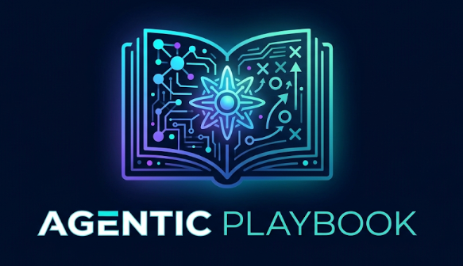

<p align="center"></p>

# Agentic Playbook

[](https://github.com/Gowrishankar4/agentic-playbook/actions/workflows/validate.yml)
[](LICENSE)

**Playbooks that every AI session continues from.** One folder per feature or program holds requirements, plan, decisions, progress and traceability. Any agent, any teammate, any day picks up exactly where the last one left off — and a *ripple sweep* keeps every file agreeing with every other after each change.

Every requirement or intent starts the same way: **`/playbook new` → a playbook.**

```
intent → setup (once) → requirements (interview) → analysis → plan → APPROVAL → work ⇄ log/decide → close
```

One skill, `/playbook`: `new` · `interview` · `work` · `log` · `decide` · `directive` · `task add` · `resume` · `audit` · `status` · `close` · `config` — plus your own commands.

| File | Owns |
|---|---|
| `PROGRESS.md` | Every task tracked from git — commit, branch, pushed, PR, tests — or `agent-tracked` when nothing is committed yet — and the log |
| `00-REQUIREMENTS.md` | Requirements refined by the interview, acceptance criteria, constraints, interview record |
| `01-ANALYSIS.md` · `02-PLAN.md` | What the code has today · how we'll do it (approval, phases, tasks) |
| `03-DECISIONS.md` · `05-DIRECTIVES.md` | Questions and answers · approver's standing rules |
| `04-TRACEABILITY.md` | Requirement → task → test → status |

**Requirements are interviewed, never guessed.** A built-in requirement interview (classify the request → read the code → ask only what's missing → draft a spec → approve) runs on `new`, `task add` and `/playbook interview [TASK]`, and saves everything into `00-REQUIREMENTS.md`: requirement rows, acceptance criteria, constraints, assumptions, and the approved spec as a dated record. Open questions become decisions.

**Works with any agent** — Claude Code, Cursor, Codex, Gemini CLI, Copilot, Windsurf, or plain chat (Claude.ai, ChatGPT).
**Tracks progress from git** — no tracker, connector or token needed. Want Jira, Linear or GitHub Issues kept in sync too? Add your own skill on an event (`task_added`, `task_done` …).
**Fits your tools** — map every step to your own skills, slash commands, MCP tools or scripts, add rules with triggers, add your own playbook files, commands and lint checks. See [CUSTOMIZING.md](CUSTOMIZING.md).

## Install

### Claude Code (plugin, gets updates)

```bash
/plugin marketplace add Gowrishankar4/agentic-playbook
/plugin install playbook@agentic-playbook
```

Commands are namespaced: `/playbook:playbook new checkout-redesign`, `/playbook:playbook interview CO-02`. Plain requests ("CO-02 is done", "the PM answered D-02") work too.

### Cursor, Codex, Gemini CLI, Windsurf, any agent with a skills folder

```bash
git clone https://github.com/Gowrishankar4/agentic-playbook
cd agentic-playbook
./install.sh --agent cursor          # copies the skill to ~/.cursor/skills/
./install.sh --dir ~/.codex/skills   # or any skills folder your agent reads
```

No skills folder? Add one line to your agent's instruction file (`AGENTS.md`, `GEMINI.md`, `.github/copilot-instructions.md`, …):
`For playbook work, follow <path>/skills/playbook/SKILL.md.`

### Claude.ai / desktop app

Zip `plugins/playbook/skills/playbook` and upload it as a skill in the app's skill settings, or paste `SKILL.md` into a project's instructions. Without file access, the skill runs in chat-only mode: you paste files in, it returns full updated files.

### Configure (optional, 1 minute)

```
/playbook config init
```

Asks for your playbook folder, preset and which of your tools to use, then writes `~/.config/playbook/config.yml`. Without config everything still works with defaults (`~/playbooks`, git tracking, built-in steps).

## Use — one feature, start to finish

```text
> /playbook new
```

**1. First run only — setup** (skippable; no config file found yet):

```text
Where should playbooks live? [~/playbooks]
Preset? feature / program / regulated
I can see these in this session — use them?
  interview → /prompt · code-analysis → code-graph · verify → /verify · commit → /commit
```
→ writes `~/.config/playbook/config.yml`. Never asked again.

**2. Name and playbook settings** (one message, every time):

```text
Name? checkout-redesign · Repos? web, api · Approver? Product lead
Modules? API-CONTRACT, TEST-CASES
```
→ folder scaffolded under your root, overrides saved to its `playbook.yml`.

**3. Gather requirements** — your mapped interview skill (e.g. `/prompt`) or the built-in one: source doc, goal, then only what the PRD and code don't answer → draft spec → your approval → saved into `00-REQUIREMENTS.md` (rows, acceptance criteria, constraints, assumptions, interview record). Open questions → `D-NN`.

**4. Analyse, plan, stop:**

```text
Plan ready — DRAFT, awaiting approval
5 requirements · 3 tasks · 2 open decisions
Blocking: D-02 "Keep guest checkout?" (blocks CO-03)
Approve?
```

```text
> approved by the product lead
> /playbook work CO-01                  # agent implements, verifies, records evidence, marks ✅
> /playbook interview CO-02            # requirements for one task → 00-REQUIREMENTS.md, approve
> /playbook resume                      # next day, any agent
Phase 1 (API) — in progress. Next: CO-02 totals endpoint.
Blocked: CO-03 by D-02.
> CO-02 is done, abc1234 on feat/totals, pushed, verify passed
```
→ task row (evidence read from git), log, traceability, phase header, dependants and the task's acceptance criteria all updated; your `task_done` rules fire.

```text
> PM answered D-02: keep guest checkout
```
→ D-02 decided, DD-02 recorded, CO-03 unblocked, every "provisional (D-02)" note resolved.

```text
> /playbook audit       # read-only lint, fixes only on approval
> /playbook status      # one line per playbook
> /playbook close       # summary, lessons → offered as new rules
```

A complete example playbook is in [`examples/checkout-redesign-playbook/`](examples/checkout-redesign-playbook/), and a day-by-day session transcript in [`docs/WALKTHROUGH.md`](docs/WALKTHROUGH.md).

## What a playbook looks like

```
checkout-redesign-playbook/
├── README.md  AGENTS.md  CLAUDE.md  playbook.yml
├── PROGRESS.md            ← every session starts here
├── 00-REQUIREMENTS.md     ← interview output lands here
├── 01-ANALYSIS.md         02-PLAN.md
├── 03-DECISIONS.md        04-TRACEABILITY.md
├── 05-…                   optional + your custom modules
└── references/  db/
```

## How it stays consistent

Each fact has one owning file; every other file refers to it by ID. After any change the **ripple sweep** updates the owner, then every reference, then recomputes derived fields (phase, next action, traceability). `audit` checks it mechanically. Design and rationale: [ARCHITECTURE.md](ARCHITECTURE.md).

## Customize

```yaml
# ~/.config/playbook/config.yml
capabilities:
  code-analysis: [skill:code-graph, builtin]
  verify:        [command:/verify, script:"make test"]
  issue-tracker: [skill:jira-comment]        # your own skill
rules:
  - id: security-review
    on_event: [task_done]
    when: { labels: [auth, payments] }
    mode: required
    use: security-review
  - id: jira-comment                                 # mirror progress to Jira on an event
    on_event: [task_done]
    use: issue-tracker
    instruction: Post a solution report; never change the issue status.
```

Everything — capabilities, rules and triggers, custom files, commands, red flags, lint checks, presets, sensitive-data profiles — is in [CUSTOMIZING.md](CUSTOMIZING.md).

## Guarantees no config can switch off

No product code before the plan is approved · evidence is never invented · no secrets or sensitive data in the folder · external systems written only with your OK · no writes to product repos unless you ask.

## Contributing

Presets, agent adapters, event skills (e.g. tracker integrations), red flags from real projects and audit checks are the most valuable contributions. See [CONTRIBUTING.md](CONTRIBUTING.md).

## License

[MIT](LICENSE) © 2026 Gowrishankar Sivagnanam
